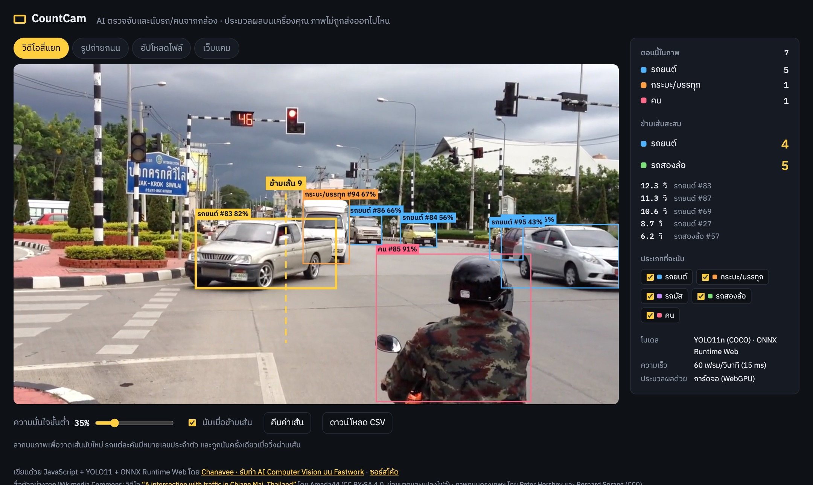
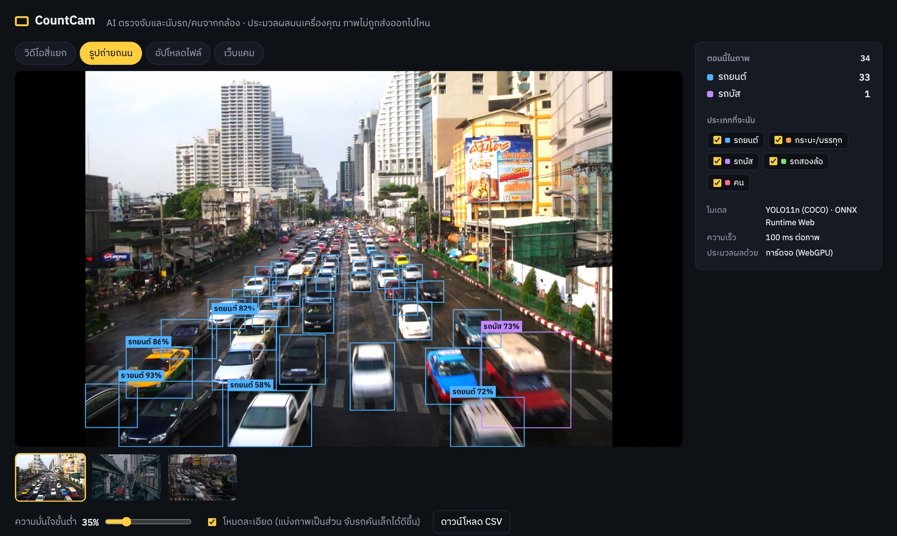
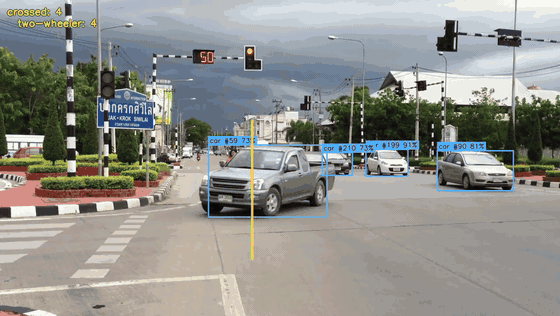

# CountCam · AI นับรถและคนจากกล้อง

**ลองใช้: https://countcam.vercel.app**

เว็บแอปที่ใช้ AI (YOLO11) ตรวจจับรถยนต์ รถกระบะ/บรรทุก รถบัส รถสองล้อ และคน จากวิดีโอ รูปภาพ หรือเว็บแคม
ติดตามรถทีละคัน (ทุกคันมีหมายเลขประจำตัว) และนับเมื่อวิ่งผ่านเส้นที่ลากเองได้ ส่งออกผลเป็น CSV
ประมวลผลในเบราว์เซอร์ทั้งหมด ภาพของผู้ใช้ไม่ถูกส่งขึ้นเซิร์ฟเวอร์



## ทำอะไรได้บ้าง

- **นับรถข้ามเส้น** ลากเส้นบนภาพได้เอง รถแต่ละคันถูกนับครั้งเดียว แยกตามประเภท พร้อมเวลาที่ข้าม
- **โหมดละเอียดสำหรับรูปภาพ** แบ่งภาพเป็นส่วนย่อยที่ซ้อนกันแล้วรวมผล (แนวเดียวกับ SAHI) ในรูปถนนกรุงเทพฯ ตัวอย่างแรก นับรถได้ 33 คัน เทียบกับ 18 คันเมื่อวิเคราะห์ทั้งภาพครั้งเดียว
- **ไม่นับคนขี่ซ้ำ** คนที่อยู่บนมอเตอร์ไซค์ถูกนับเป็นรถสองล้อ 1 คัน ไม่ใช่คนเดินถนน
- **ใช้กับกล้องจริงได้** เปิดเว็บแคมหรือกล้องมือถือได้ทันที หรืออัปโหลดวิดีโอ/รูปของตัวเอง
- **ส่งออก CSV** วิดีโอได้รายการรถที่ข้ามเส้นพร้อมเวลา ส่วนรูปภาพได้ตำแหน่งของทุกวัตถุ
- **เร็ว** ประมาณ 30 เฟรม/วินาทีบน MacBook ที่ใช้การ์ดจอผ่าน WebGPU ถ้าเบราว์เซอร์ไม่มี WebGPU จะใช้ CPU (WebAssembly) แทน



## เวอร์ชัน Python (YOLO11 + ByteTrack)

โฟลเดอร์ [`python/`](python/) เป็นสคริปต์ที่ทำงานแบบเดียวกันบนคอมพิวเตอร์ ใช้กับไฟล์วิดีโอหรือกล้อง (เช่น IP camera หรือเว็บแคม) ได้ทั้งคู่ ผลลัพธ์คือวิดีโอที่วาดกรอบแล้ว และไฟล์ CSV

```bash
cd python
python3 -m venv .venv && source .venv/bin/activate
pip install -r requirements.txt
python count_video.py ../public/samples/chiangmai.mp4 --out out.mp4 --csv crossings.csv
# ใช้เว็บแคม:  python count_video.py 0 --show
```



## ทำงานอย่างไร

```
วิดีโอ / รูป / กล้อง
   → ย่อและเติมขอบเป็น 640×640 (letterbox)
   → YOLO11n (ONNX Runtime Web: WebGPU หรือ WebAssembly)
   → กรองประเภทที่สนใจ + NMS + ตัดคนขี่ออก
   → tracker จับคู่กรอบระหว่างเฟรม (IoU + ระยะจุดศูนย์กลาง)
   → ถ้าเส้นทางของรถตัดกับเส้นนับ → นับ 1 ครั้ง
```

| ไฟล์ | หน้าที่ |
|------|---------|
| [`public/detector.js`](public/detector.js) | โหลดโมเดล ONNX, เตรียมภาพ, แปลงผลลัพธ์ YOLO เป็นกรอบ และทำ NMS |
| [`public/tracker.js`](public/tracker.js) | ติดตามวัตถุข้ามเฟรม, ตรวจการข้ามเส้น, รวมผลจากภาพย่อย, ตัดคนขี่ |
| [`public/app.js`](public/app.js) | หน้าเว็บ: เลือกแหล่งภาพ วาดกรอบ ลากเส้น สรุปผล และส่งออก CSV |
| [`python/count_video.py`](python/count_video.py) | เวอร์ชัน Python ใช้ Ultralytics YOLO11 + ByteTrack + OpenCV |
| [`python/export_onnx.py`](python/export_onnx.py) | แปลง `yolo11n.pt` เป็น `public/models/yolo11n.onnx` ให้เว็บใช้ |

## รันบนเครื่อง

เว็บเป็นไฟล์ static ทั้งหมด ไม่ต้อง build:

```bash
cd public && python3 -m http.server 5180
# เปิด http://localhost:5180  (เติม ?debug จะได้ตัวแปร window.countcam ไว้ดูสถานะ)
```

## ข้อจำกัดที่ควรรู้

- โมเดลเป็น YOLO11n ที่ฝึกด้วยชุดข้อมูล COCO ใช้งานทั่วไปได้ดี แต่รถที่อยู่ไกลมาก ถูกบังมาก หรือภาพกลางคืนจะพลาดได้ งานจริงควรเก็บภาพจากกล้องของหน้างานมาฝึกโมเดลเพิ่ม (fine-tune)
- ในคลิปตัวอย่าง (14 วินาที) มีรถข้ามเส้นจริงประมาณ 11 คัน เว็บนับได้ 10 คันที่ความมั่นใจขั้นต่ำ 35% ส่วนคันที่หลุดคือมอเตอร์ไซค์ที่ถูกรถกระบะบังขณะข้ามเส้น
- กล้องที่ติดตั้งสูงและมองลงมาให้ผลดีกว่ากล้องระดับสายตา เพราะรถบังกันน้อยกว่า

## เครดิตและสัญญาอนุญาต

- โค้ดในโปรเจกต์นี้เผยแพร่ภายใต้ [AGPL-3.0](LICENSE) เพื่อให้สอดคล้องกับโมเดล [Ultralytics YOLO11](https://github.com/ultralytics/ultralytics) (AGPL-3.0)
- วิดีโอ [“A intersection with traffic in Chiang Mai, Thailand”](https://commons.wikimedia.org/wiki/File:A_intersection_with_traffic_in_Chiang_Mai,_Thailand.ogv) โดย Amada44 ใช้ภายใต้ CC BY-SA 4.0 (ย่อขนาดและแปลงเป็น MP4)
- ภาพถนนกรุงเทพฯ จาก Wikimedia Commons โดย Bernard Spragg และ Peter Hershey (CC0)

---

ทำโดย Chanavee (นักศึกษาวิศวกรรมคอมพิวเตอร์ มจธ.) · รับทำงาน AI Computer Vision ผ่าน [Fastwork](https://fastwork.co/user/chasvitf)

**English:** CountCam is an in-browser vehicle and people counter. It runs YOLO11n on ONNX Runtime Web (WebGPU, with a WebAssembly fallback), tracks objects across frames, counts the ones that cross a line you draw, and exports CSV. Sliced inference finds the small cars in still photos. The `python/` folder has the same pipeline built on Ultralytics YOLO11, ByteTrack and OpenCV.
